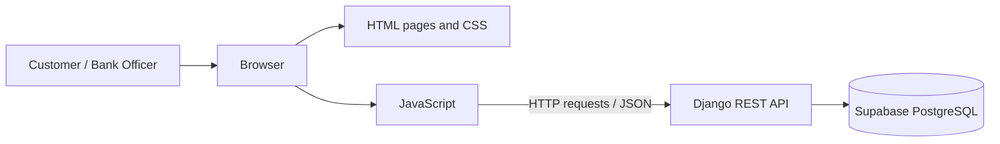

BankEase – Frontend
Project: BankEase – NextGen Net Banking Application
Project Code: P18
Repository: Bankease-Frontend

The BankEase frontend is the browser-based user interface for the BankEase academic banking application. It provides separate customer and bank-officer experiences and communicates with the Django REST API for authentication and banking operations.
Academic demo notice: BankEase is a learning project. Transfers, balances, bill payments, loans and investments shown in this application are demo operations. The application is not connected to the banking network and must not be used for real-money transactions or real customer data.

Main features
Customer interface
- Landing page, customer registration and sign-in.
- Customer dashboard and account information.
- Account-related pages and beneficiary management.
- Demo fund-transfer form and transaction history.
- Bill-payment interface.
- Loan application and loan information pages.
- Investment information and investment tracking pages.
- Notifications and customer-support pages.
Bank-officer interface
- Role-based dashboard presentation.
- Overview cards for customers, accounts, deposits and pending requests.
- Account-opening request review.
- Loan-application review and authorization workflow.
- Access to transaction/audit information exposed by the backend.
The available pages in this repository include index.html, login.html, register.html, dashboard.html, accounts.html, beneficiaries.html, transfer.html, transactions.html, bill-payments.html, loans.html, investments.html, notifications.html and support.html.
Technology stack
- HTML5 – page structure.
- CSS3 – layout, styling and responsive presentation.
- Vanilla JavaScript (ES6+) – UI behaviour and API communication.
- Lucide – icons loaded by the landing page from a CDN.
- Django REST Framework API – backend services consumed by the frontend.
- Netlify – static-site hosting.
There is no frontend framework or Node.js build step in the current repository. The site is served as static HTML, CSS and JavaScript. The repository contains css/, js/ and the HTML pages listed above. netlify.toml sets the publish directory to the repository root and configures response headers.
Application architecture

The frontend is responsible for displaying information, collecting form input and sending requests to the backend. Authentication, authorization, validation and database updates must be enforced by the backend; client-side checks alone are not a security control.
Repository structure
Bankease-Frontend/
├── css/
│   ├── style.css
│   ├── components.css
│   └── responsive.css
├── js/
│   └── JavaScript files for page behaviour and API integration
├── index.html
├── login.html
├── register.html
├── dashboard.html
├── accounts.html
├── beneficiaries.html
├── transfer.html
├── transactions.html
├── bill-payments.html
├── loans.html
├── investments.html
├── notifications.html
├── support.html
├── netlify.toml
└── .gitignore
The JavaScript filenames may change as the project evolves; use the actual files in the js/ directory as the source of truth.
Run locally
The frontend requires the Django backend to be running for API-powered features.
1. Start the backend
Follow the setup instructions in the Backend README. The local API is expected to be available at:
http://127.0.0.1:8000/api/v1/
2. Configure the frontend API URL
Open the JavaScript configuration/API integration file in js/ and set its API base URL to the local backend address above. For a deployed frontend, configure it to use the deployed Render backend URL instead. Do not place database passwords, Django secret keys or other private credentials in frontend JavaScript; browser code is public.
3. Serve the frontend
From the frontend repository directory, run:
python -m http.server 5500
Open:
http://127.0.0.1:5500/index.html
You can also use an editor's Live Server extension. Running the HTML file directly with a file:// URL is not recommended because browser/API behaviour can differ from a normal HTTP origin.
Deployment on Netlify
The repository includes a netlify.toml configuration with:
- Publish directory: . (repository root).
- Response headers including X-Frame-Options, X-Content-Type-Options and X-XSS-Protection.
Typical deployment steps:
1. Sign in to Netlify and create a site from the Bankease-Frontend GitHub repository.
2. Select the main branch.
3. Use the repository root (.) as the publish directory. No build command is required for the current static frontend.
4. Deploy the site and copy its public HTTPS URL.
5. Update the frontend API base URL to the deployed backend URL.
6. Add the Netlify site origin to the backend's CORS configuration. Add it to trusted CSRF origins too if the backend's authentication/configuration requires it.
7. Push frontend changes to GitHub and check the Netlify deployment result.
The frontend and backend must use matching deployment URLs and CORS settings. A frontend deployment can load successfully while API requests still fail if the API URL or CORS configuration is incorrect.
Important configuration and security notes
- Keep API base URLs environment-specific: local development should point to localhost; the deployed site should point to the Render service.
- Never put database credentials, secret keys or private tokens in this repository.
- Do not rely on frontend validation to protect balances, user roles or transactions. The backend must validate every sensitive request.
- Do not store real banking credentials or personal financial information in this academic demo.
- Use HTTPS for deployed environments.
Related repositories
- Backend – Django REST API
- Deployment – Docker Compose and Render configuration
Project scope
BankEase demonstrates a full-stack web application structure and common banking workflows for academic learning. It is not a licensed banking product, payment processor or production financial system. Real banking would require regulated integrations, security audits, identity verification, operational controls and authorization from the relevant institutions.
